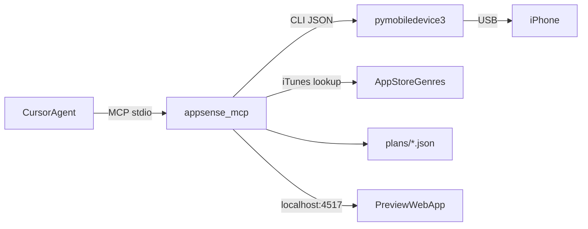

# AppSense

AI organization for your iPhone home screen, driven from Cursor.

AppSense is a local [MCP](https://modelcontextprotocol.io) server. It reads the apps and current home screen
layout from an iPhone connected over USB. Cursor's agent then designs a better layout, and AppSense validates it
and turns it into a visual before/after preview. When you approve, AppSense writes the new layout straight to
the phone over USB, after backing up the old one so it can be undone.
No API keys are needed: Cursor's agent is the AI.

## Setup

1. Install the device bridge: `pipx install pymobiledevice3`.
2. Plug the iPhone into your Mac, unlock it, and tap **Trust**.
3. Build everything: `pnpm install && pnpm build`.
4. Open this folder in Cursor. The `appsense` server is registered in [.cursor/mcp.json](.cursor/mcp.json);
   enable it under Cursor Settings > MCP if prompted.
5. In chat, ask something like: _"Organize my iPhone home screen so everything fits on two pages."_

The agent follows [.cursor/rules/appsense.mdc](.cursor/rules/appsense.mdc). It reads the device, proposes a layout,
fixes any validation errors, and gives you a link such as `http://localhost:4517/?plan=...`. Ask it to apply the
plan and it rearranges the phone directly; ask it to undo and it restores the backup.

## The preview

The preview compares your current home screen with the proposed one. Amber dots mark apps that move, and red marks
apps going to the App Library. Folders open to show their contents. Below that, a checklist walks through
the changes in order (clear out, folders, dock, then page by page) and saves your progress in the browser.

Run it without Cursor using `pnpm preview`, or with hot reload using `pnpm dev:preview` (start `pnpm preview` too, for the API).

## MCP tools

| Tool | Purpose |
| --- | --- |
| `device_status` | Connected iPhones and whether this Mac is trusted |
| `list_installed_apps` | Apps with bundle id, App Store genre, and current location |
| `get_current_layout` | Current home screen (readable view and compact spec) |
| `propose_layout` | Validate a layout, save a plan, and return the preview link |
| `apply_layout` | Write a plan to the iPhone (backs up the current layout first) and verify the result |
| `restore_layout` | List backups, or write one back to the iPhone to undo a change |
| `get_apply_guide` | The plan's manual steps as markdown, for applying by hand |
| `list_plans` / `open_preview` | Browse saved plans and open one in the browser |

## Project layout

- [packages/core](packages/core): layout schema, SpringBoard normalization, validation, diff, and guide generation (no I/O)
- [packages/mcp-server](packages/mcp-server): MCP tools, the pymobiledevice3 bridge, genre lookup, plan storage, and the preview HTTP server
- [apps/preview](apps/preview): React + Tailwind preview UI

Run `pnpm test` for the core unit tests.

## Configuration

| Variable | Default | Meaning |
| --- | --- | --- |
| `APPSENSE_PORT` | `4517` | Preview server port |
| `APPSENSE_PMD_BIN` | auto-detected | Path to `pymobiledevice3` |
| `APPSENSE_DATA_DIR` | `~/.appsense` | Cache for icons and App Store genres, and layout backups |
| `APPSENSE_PLANS_DIR` | `./plans` | Where plans are saved |
| `APPSENSE_STORE_COUNTRY` | `us` | App Store region for genre lookups |

## Known limits

- Layouts are written with SpringBoard's `setIconState` service (the one iTunes used). It can arrange pages, folders,
  the dock, and widgets, but it can't send apps to the App Library: any app left out of the layout is added on extra
  pages at the end. Hide those pages once (long-press, tap the page dots, uncheck them) and the apps live only in the
  App Library.
- Widgets and Smart Stacks are treated as fixed-size blocks. They can be moved or removed, but not resized or added.
- Icon placement follows iOS's top-left fill order. Exact positions around widgets can differ slightly on the phone.
- Apps with no App Store listing (sideloaded, enterprise, or TestFlight builds) show as genre "Unknown".
